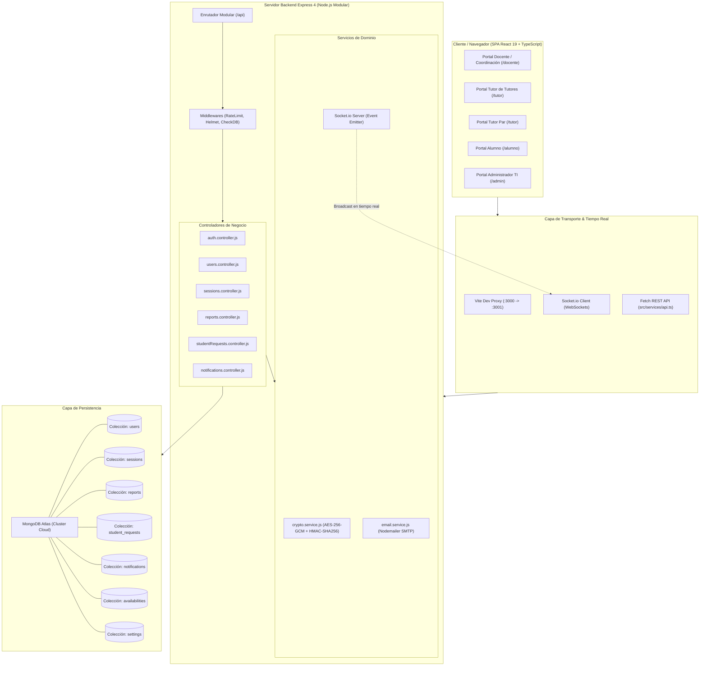
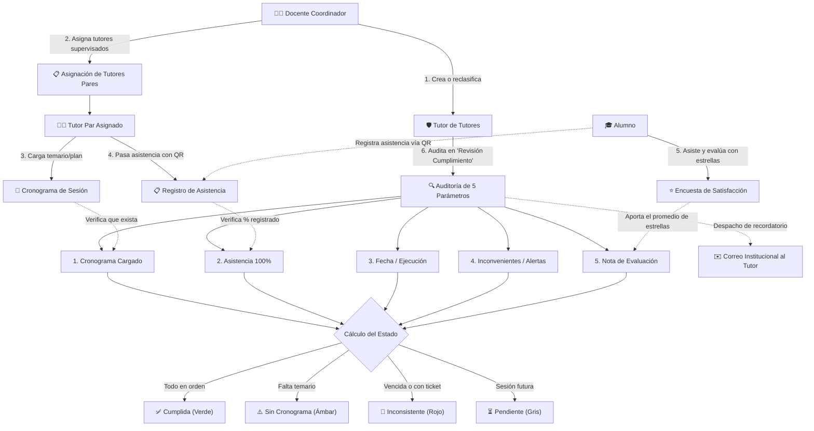
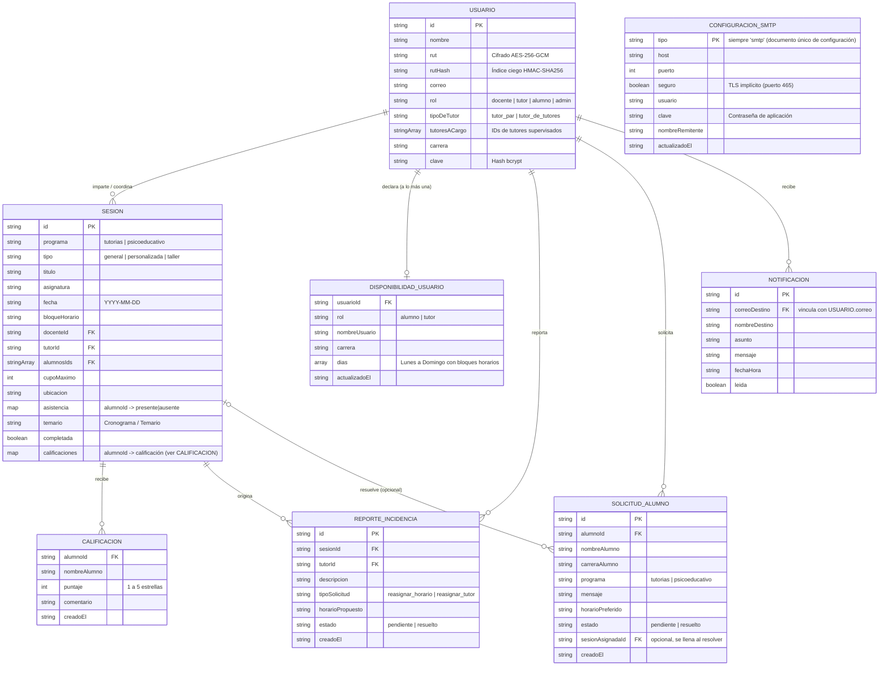
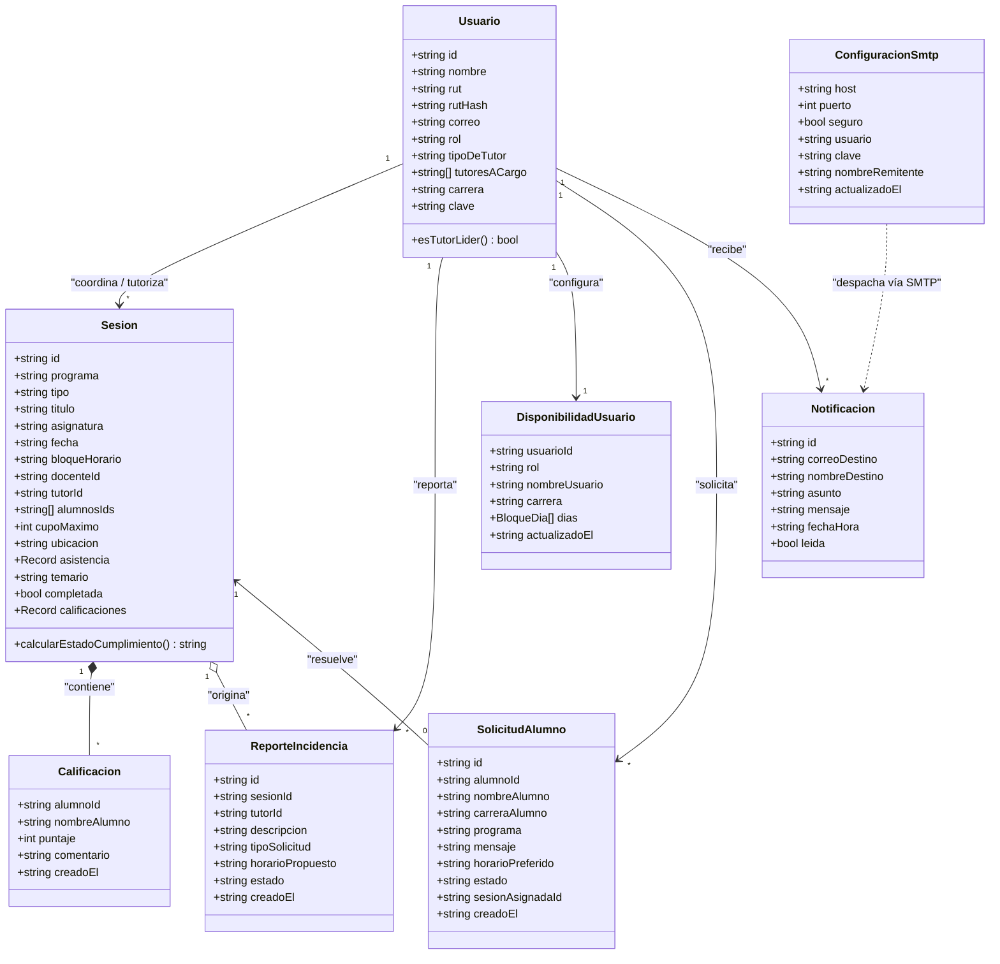
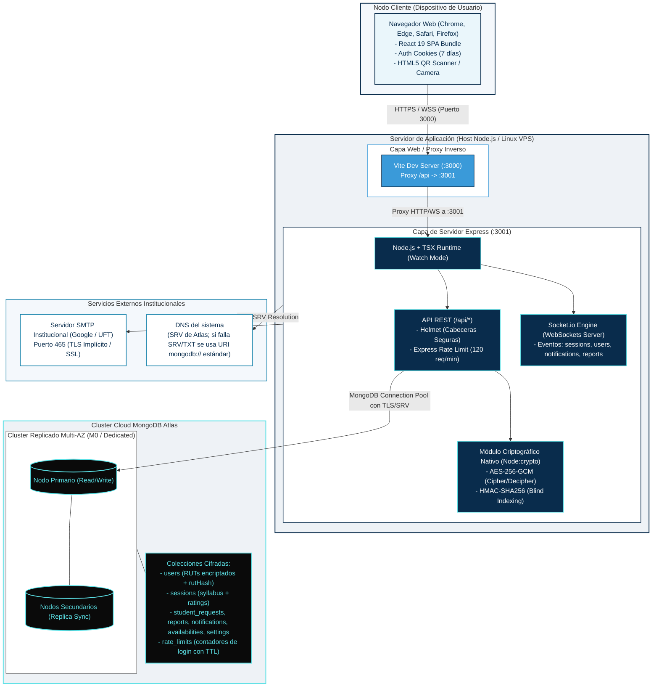

# Trayectoria Estudiantil UFT - Documento de Contexto

## 1. Descripción General del Proyecto

**Trayectoria UFT.** es una plataforma web integral desarrollada para la **Universidad Finis Terrae (UFT)** orientada a la gestión, reserva, coordinación flexible y seguimiento de programas de apoyo académico y acompañamiento estudiantil:
- **Programa de Tutorías Académicas (Entre Pares y Docentes)**.
- **Programa de Apoyo Psicoeducativo (Talleres de Hábitos de Estudio, Manejo de Ansiedad y Asesorías Individuales)**.

La aplicación permite la interacción fluida y modular de cuatro roles clave: **Docentes / Coordinadores**, **Tutores (Pares)**, **Alumnos** y **Administrador del Sistema**.

---

## 2. Diagramas de Arquitectura y Flujos del Sistema

### A. Arquitectura General del Sistema (C4 Container View)



### B. Flujo de Coordinación, Supervisión y Revisión de Cumplimiento



### C. Diagrama de Entidad-Relación (Modelo de Datos)

> Nota: los nombres de tablas y campos se muestran en español para
> facilitar la lectura; en la base de datos real (colecciones de MongoDB
> Atlas) los campos usan los mismos nombres en inglés del código fuente
> (`src/types.ts`). Se incluyen las 7 colecciones reales del sistema
> (`users`, `sessions`, `student_requests`, `reports`, `notifications`,
> `availabilities`, `settings`) más `CALIFICACION`, que no es una
> colección propia sino una sub-estructura embebida dentro de `SESION`
> (campo `ratings`).



### D. Diagrama de Clases y Modelos de Dominio

> Nota: los nombres de clases y campos se muestran en español para que el
> diagrama sea legible por cualquier persona del equipo; en el código
> fuente (`src/types.ts`) estos mismos campos están en inglés (`id`,
> `name`, `rut`, etc.), siguiendo la convención habitual de TypeScript.



### E. Diagrama de Componentes de Frontend y Backend

```mermaid
flowchart TD
    subgraph UI["Capa de Presentación (React 19 SPA)"]
        App["App.tsx (Enrutador Principal)"]
        AuthCtx["AuthContext.tsx (Sesión y Cookies)"]
        ProtRoute["ProtectedRoute.tsx (Control por Rol)"]
        
        subgraph Portales["Vistas por Rol"]
            DocenteDash["DocenteDashboard.tsx"]
            TutorDash["TutorDashboard.tsx"]
            AlumnoDash["AlumnoDashboard.tsx"]
            AdminDash["AdminDashboard.tsx"]
        end

        subgraph DocenteComponents["Módulos Docente"]
            DocCalendar["DocenteCalendarTab"]
            DocTutors["DocenteTutorsTab (Gestión y Asignación)"]
            DocAtt["DocenteAttendanceTab"]
            DocFlex["DocenteFlexScheduleTab"]
            DocAlerts["DocenteAlertsTab"]
            DocAnnc["DocenteAnnouncementsTab"]
            DocAnalytics["DocenteAnalyticsTab"]
            DocComments["DocenteCommentsTab"]
        end

        subgraph TutorComponents["Módulos Tutor"]
            TutSchedule["Mis Tutorías (Cronograma)"]
            TutAtt["Pasar Lista (Asistencia + QR + Inscripción Manual)"]
            TutAvail["Cargar Horario Semanal"]
            TutIssue["Avisar Inconveniente"]
            TutAssigned["Tutores a Cargo (Métricas)"]
            TutCompliance["Revisión Cumplimiento (Auditoría 5 Parámetros)"]
        end

        subgraph AlumnoComponents["Módulos Alumno"]
            AluExplore["Explorador & Reserva Tutorías"]
            AluBookings["Mis Reservas Activas"]
            AluHistory["Historial Clases (Temario Desplegable + Encuesta)"]
            AluAvail["Cargar Disponibilidad"]
            AluIssue["Avisar Inconveniente Flexible"]
        end

        subgraph SharedComponents["Componentes Comunes"]
            QRModal["SessionQRModal / MobileQRScanner"]
            ThemeTgl["ThemeToggle (Modo Claro/Oscuro)"]
            ModalNotifs["Bandeja de Notificaciones"]
        end
    end

    subgraph ClientServices["Capa de Servicios Frontend"]
        ApiClients["src/services/api.ts (authApi, sessionsApi, usersApi, reportsApi)"]
        SocketSvc["src/services/socket.ts (WebSockets Client)"]
    end

    subgraph ServerComponents["Capa de Servidor Backend Express"]
        MasterRouter["server/routes/index.js"]
        
        subgraph ControllersPkg["Controladores"]
            AuthC["auth.controller.js"]
            UsersC["users.controller.js"]
            SessionsC["sessions.controller.js"]
            ReportsC["reports.controller.js"]
            ReqsC["studentRequests.controller.js"]
            NotifsC["notifications.controller.js"]
            SettingsC["settings.controller.js"]
            BroadcastC["broadcast.controller.js"]
        end

        subgraph ServicesPkg["Servicios de Negocio"]
            CryptoS["crypto.service.js (AES-256-GCM + HMAC-SHA256)"]
            EmailS["email.service.js (Nodemailer Transporter)"]
            CronS["cron.service.js (Alertas Automáticas)"]
        end
    end

    subgraph DBCluster["Persistencia de Datos"]
        MongoDriver["MongoClient Connection Pool"]
        MongoAtlas[("MongoDB Atlas Database")]
    end

    App --> AuthCtx --> ProtRoute
    ProtRoute --> Portales
    DocenteDash --> DocenteComponents
    TutorDash --> TutorComponents
    AlumnoDash --> AlumnoComponents
    Portales --> SharedComponents
    DocenteComponents & TutorComponents & AlumnoComponents --> ClientServices
    ApiClients & SocketSvc --> MasterRouter
    MasterRouter --> ControllersPkg
    ControllersPkg --> ServicesPkg
    ControllersPkg --> MongoDriver --> MongoAtlas

    classDef entry fill:#092c4c,stroke:#5ce1e6,stroke-width:2px,color:#ffffff
    classDef dash fill:#3a9ad9,stroke:#092c4c,stroke-width:1.5px,color:#ffffff
    classDef feature fill:#eaf6fb,stroke:#3a9ad9,stroke-width:1px,color:#092c4c
    classDef shared fill:#ffffff,stroke:#0a0a0a,stroke-width:1px,color:#092c4c
    classDef clientsvc fill:#7bd6e0,stroke:#092c4c,stroke-width:1.5px,color:#092c4c
    classDef backend fill:#092c4c,stroke:#3a9ad9,stroke-width:1.5px,color:#ffffff
    classDef service fill:#0f7ea8,stroke:#092c4c,stroke-width:1.5px,color:#ffffff
    classDef db fill:#0a0a0a,stroke:#5ce1e6,stroke-width:2px,color:#5ce1e6

    class App,AuthCtx,ProtRoute entry
    class DocenteDash,TutorDash,AlumnoDash,AdminDash dash
    class DocCalendar,DocTutors,DocAtt,DocFlex,DocAlerts,DocAnnc,DocAnalytics,DocComments,TutSchedule,TutAtt,TutAvail,TutIssue,TutAssigned,TutCompliance,AluExplore,AluBookings,AluHistory,AluAvail,AluIssue feature
    class QRModal,ThemeTgl,ModalNotifs shared
    class ApiClients,SocketSvc clientsvc
    class MasterRouter,AuthC,UsersC,SessionsC,ReportsC,ReqsC,NotifsC,SettingsC,BroadcastC backend
    class CryptoS,EmailS,CronS service
    class MongoDriver,MongoAtlas db

    style UI fill:#f4f8fc,stroke:#092c4c,stroke-width:2px
    style Portales fill:#ffffff,stroke:#3a9ad9,stroke-width:1.5px
    style DocenteComponents fill:#eef7fb,stroke:#3a9ad9,stroke-width:1px
    style TutorComponents fill:#eef7fb,stroke:#0f7ea8,stroke-width:1px
    style AlumnoComponents fill:#eef7fb,stroke:#5ce1e6,stroke-width:1px
    style SharedComponents fill:#ffffff,stroke:#64748b,stroke-width:1px,stroke-dasharray: 4 3
    style ClientServices fill:#eaf6fb,stroke:#092c4c,stroke-width:2px
    style ServerComponents fill:#f1f5fb,stroke:#092c4c,stroke-width:2px
    style ControllersPkg fill:#ffffff,stroke:#092c4c,stroke-width:1px
    style ServicesPkg fill:#ffffff,stroke:#0f7ea8,stroke-width:1px
    style DBCluster fill:#eef2f6,stroke:#092c4c,stroke-width:2px
```



### F. Diagrama de Despliegue de Infraestructura



---

## 3. Stack Tecnológico

### Frontend
- **Framework / Librería**: React 19 con TypeScript.
- **Enrutamiento Declarativo**: `react-router-dom` v6 con rutas por rol (`/login`, `/docente`, `/alumno`, `/tutor`, `/admin`, `/reset-password`) y guardas de acceso (`ProtectedRoute`).
- **Bundler & Dev Server**: Vite 6 con soporte de proxy para endpoints `/api` hacia `http://localhost:3001`.
- **Estilos**: Tailwind CSS v4 (`@tailwindcss/vite`) con paleta institucional UFT (`#092c4c`, `#3a9ad9`).
- **Iconografía & Animación**: `lucide-react`, `motion` (Framer Motion).
- **Capa de Servicios**: Clientes API tipados en `src/services/api.ts`.
- **Rendimiento de Carga**:
  - **Code splitting por ruta** (`React.lazy` + `Suspense` en `App.tsx`): cada portal (`/docente`, `/tutor`, `/alumno`, `/admin`) y la pantalla de restablecer contraseña se descargan solo al entrar. El login no carga código de los paneles.
  - **Versión visible**: `vite.config.ts` lee `version` de `package.json` y la inyecta como `__APP_VERSION__` (declarada en `src/vite-env.d.ts`). Se muestra "v 1.0.x" en la barra inferior de alumno y tutor, y en la esquina inferior derecha en el resto (`FloatingVersion` en `App.tsx`). En cada commit se sube el último número (1.0.1 → 1.0.2) en `package.json` y `package-lock.json` para comprobar qué versión desplegó Vercel.
  - **Librerías pesadas bajo demanda**: `exceljs` se importa dinámicamente al exportar, `html5-qrcode` al abrir el escáner QR del alumno, y `DocenteAnalyticsTab` al abrir Métricas.
  - **Vendor chunks** (`vite.config.ts` → `manualChunks`): `vendor-react`, `vendor-realtime`, `vendor-icons`, para que el navegador los conserve en caché entre despliegues.
  - **Fuentes**: Google Fonts se enlaza desde `index.html` con `preconnect` (no vía `@import` en CSS, que bloqueaba el primer pintado).
  - **Tiempo real**: las recargas disparadas por WebSockets se agrupan (250 ms) y los eventos `notifications:changed` dirigidos a otro usuario se ignoran.
  - **Firefox**: se desactiva `backdrop-filter` en capas de modal a pantalla completa (`@supports (-moz-appearance: none)` en `index.css`); se respeta `prefers-reduced-motion`.
- **Persistencia de Sesión**: La autenticación real es la cookie `uft_session` (httpOnly, SameSite=Lax, `Secure` en producción, 7 días), firmada con HMAC-SHA256 por el servidor (`server/services/session.service.js`, secreto `SESSION_SECRET`). Solo contiene el id del usuario y su expiración; el navegador no puede leerla ni falsificarla. Se crea en `/api/login` y `/api/register` y se borra en `/api/logout`. Además, `AuthContext` mantiene la cookie legible `uft_session_user` con una copia del usuario solo para la interfaz (portal elegido, `role` / `tutorType`); la refresca desde `/api/me` al abrir la app y ante cada evento `users:changed`, y cierra la sesión local si el servidor responde 401.
- **Autorización en la API (`server/middlewares/auth.js`)**: Son públicas solo `/api/login`, `/api/logout`, `/api/register` (crea únicamente alumnos), `/api/forgot-password`, `/api/verify-reset-token` y `/api/reset-password`. Todo lo demás pasa por `requireAuth`, que valida la firma y carga el usuario desde MongoDB en cada petición (los roles revocados o las cuentas borradas pierden el acceso al instante). `requireRole` restringe: `/api/system/*`, `/api/settings/*`, `/api/health`, `/api/cron/remind-tutors` y `/api/test/*` solo admin; `/api/broadcast-message` y crear/editar/eliminar usuarios, admin o docente. Solo un admin puede crear, editar o eliminar cuentas admin o asignar ese rol.
- **Datos según rol (nov 2026, tras la prueba con alumnos)**: helpers `isStaff` (admin/docente), `isTutorOrStaff` y `canSendTo` en `server/middlewares/auth.js`. Un usuario solo alumno (sin rol tutor/docente/admin):
  - `GET /api/users`: recibe sus propios datos completos y, de tutores y docentes, solo `id`, `name`, roles y tipo de tutor (y el correo de los docentes, para avisarles inconvenientes). Nunca el RUT ni los datos de otros alumnos.
  - `GET /api/sessions` (y las respuestas de `/enroll` y QR): los demás inscritos se reemplazan por `otro_<n>` (se conserva la cantidad para los cupos), y `attendance`/`ratings` solo traen su entrada.
  - `/api/notifications`: solo las suyas (el `email` de la consulta se ignora), y solo marca como leídas las suyas. `/api/student-requests`: solo las suyas, y al crear se fuerza `studentId`/`studentName`/`status`. `/api/availabilities`: solo la suya, y solo guarda la suya. `/api/reports`: lista vacía.
  - `POST /api/notifications` y `/api/send-email`: solo a su propio correo o al de un docente/admin, y sin cambiar el remitente (`fromName`).
  - `PUT /api/sessions/:id`: solo puede guardar `ratings.<su id>` en una sesión donde está inscrito.
  - Crear o eliminar sesiones, y editar reportes o solicitudes (`PUT`), queda solo para admin/docente.
  - Tutores y coordinación siguen recibiendo los datos completos (pasan lista, ven RUT y correos de sus alumnos).
  - Los eventos de Socket.io siguen enviando la sesión completa (en Vercel no hay WebSockets).
- **Sin base de datos local**: Todos los datos de negocio (usuarios, sesiones, reportes, solicitudes, disponibilidades, notificaciones, SMTP) se leen y escriben únicamente en MongoDB Atlas vía `/api`. No existe caché ni respaldo en `localStorage`: si una escritura falla, la interfaz muestra el error en lugar de simular el guardado. `localStorage` se usa solo para preferencias de interfaz (pestaña activa, tema). Los tutoriales vistos se guardan en MongoDB (`users.tutorialsSeen`).

### Backend & Seguridad
- **Runtime & Servidor**: Node.js con Express 4 modularizado por capas (Controladores, Servicios, Rutas y Middlewares).
- **Base de Datos**: MongoDB Atlas (driver oficial `mongodb` v7.x con pool de conexiones y cache `cachedDb`). Cluster en AWS `SA_EAST_1` (São Paulo).
  - **Conexión (`server/db.js`)**: `connectDB()` comparte una sola conexión en curso entre peticiones simultáneas. Si `connect()` falla se descarta ese cliente (evita "Topology is closed") y el siguiente intento crea uno nuevo. Usa el DNS del sistema; si la consulta `querySrv`/`queryTxt` de una URI `mongodb+srv://` falla (routers que no responden TXT o bloquean DNS públicos), resuelve los hosts por SRV y reintenta con una URI estándar `mongodb://` (`tls=true`, `authSource=admin`). Al conectar crea el índice `users.rutHash` y el índice único `email_unique` sobre `users.email` (sin distinguir mayúsculas: colación `es`, fuerza 2; solo correos no vacíos).
- **Despliegue**: Vercel (`vercel.json`): `/api/*` → `api/index.js` (exporta la app Express como función serverless), resto → SPA. Funciones en la región `gru1` (São Paulo), la misma que Atlas, para minimizar la latencia de cada consulta. Variables obligatorias definidas en Vercel (Production y Preview) como Secret. Limitaciones en serverless: Socket.io no mantiene conexiones y el cron con `setInterval` no se ejecuta.
- **Seguridad Criptográfica & Datos Sensibles**:
  - **Cifrado en Reposo (Field-Level Encryption)**: RUTs cifrados en MongoDB Atlas con **AES-256-GCM** (`enc:<iv>:<tag>:<cipher>`) usando clave simétrica de 256 bits (`DATA_ENCRYPTION_KEY`).
  - **Blind Index Determinístico**: Búsquedas instantáneas $O(1)$ en MongoDB mediante **HMAC-SHA256** (`rutHash`).
  - **Hashing de Contraseñas**: `bcrypt` (módulo nativo, compatible con los hashes previos de `bcryptjs`) con salt rounds para contraseñas de usuarios.
  - **Protección HTTP**: `helmet` y `express-rate-limit` (`server/middlewares/rateLimiters.js`). `app.set('trust proxy', 1)` para leer la IP real tras Vercel/Vite. **En una sala todos salen con la misma IP de la universidad**, por eso los límites no son solo por IP:
    - General: 300 req/min por usuario en sesión (600 por IP sin sesión).
    - `/api/login`: 10 intentos **fallidos** en 5 min por IP + identificador (`loginLimiter`) y 300 fallidos por IP (`loginIpLimiter`); los ingresos correctos no cuentan (`skipSuccessfulRequests`).
    - `/api/register`: contador propio (`registerLimiter`, 100 fallidos/15 min por IP); antes compartía el del login.
    - `/api/forgot-password`: 5 solicitudes cada 15 min por IP + identificador. `/api/reset-password`: 10 fallidos por IP + token. `/api/change-password`: 10 fallidos en 5 min por usuario (va después de `requireAuth`).
    - Todos menos el general guardan su contador en la colección `rate_limits` de MongoDB (`mongoRateLimitStore.js`, TTL sobre `expiresAt`) para que valgan entre instancias serverless; si Mongo falla dejan pasar la petición (`passOnStoreError`). El general sigue en memoria.
  - **Variables de entorno obligatorias** (`server/config/env.js`): `MONGODB_URI`, `SESSION_SECRET`, `DATA_ENCRYPTION_KEY` (64 hex) y `HMAC_SECRET`. No hay valores de respaldo en el código: si faltan, el arranque lo registra y las operaciones de cifrado/sesión fallan con un error explícito.
  - **Login**: busca por `rutHash` (índice creado al conectar). Las cuentas antiguas sin `rutHash` se buscan solo entre esas y se les guarda el hash al entrar. El identificador puede ser **RUT o correo**: si contiene `@` se busca por `email` (exacto, sin distinguir mayúsculas, `findUserByEmail` en `users.controller.js`). Usuario inexistente y contraseña incorrecta responden el mismo mensaje (`Usuario o contraseña incorrectos.`).
  - **Errores 500** (`server/utils/errors.js`, `sendServerError`): el detalle se registra en el log; en producción la respuesta es un mensaje genérico (en desarrollo incluye `details`). Las rutas de diagnóstico solo para admin (SMTP, cron, sistema, health) siguen devolviendo `details`.
- **Servicio de Correos**: `nodemailer` para envíos reales vía Google SMTP / Gmail institucional configurables desde el panel de administración.
- **Ejecución TypeScript/ESM**: `tsx` para scripts y servidor Node.
- **Entorno de Desarrollo & CLI**: Antigravity CLI (`agy`) habilitado globalmente y accesos directos configurados en el Escritorio.

---

## 3. Lanzadores y Acceso Rápido (Antigravity CLI / Escritorio)
- **Comando en Terminal**: `agy` (o `antigravity-ide`) disponible directamente desde cualquier terminal de PowerShell o CMD.
- **Acceso Directo en Escritorio**:
  1. `Antigravity - Trayectoria UFT.lnk`: Acceso directo nativo con icono oficial de Antigravity que abre la carpeta del proyecto.
  2. `Abrir Antigravity - Trayectoria UFT.bat`: Script ejecutable sin restricciones para iniciar el entorno en esta carpeta de trabajo.

---

## 4. Estructura de Directorios Modular

```plaintext
trayectoria-estudiantil-uft/
├── .env / .env.example          # Variables de entorno (MONGODB_URI, SESSION_SECRET, DATA_ENCRYPTION_KEY, HMAC_SECRET, SMTP)
├── vercel.json                  # Rewrites /api y SPA, región de funciones gru1
├── package.json                 # Dependencias y scripts de ejecución
├── tsconfig.json                # Configuración de TypeScript
├── vite.config.ts               # Configuración de Vite y proxy backend (/api -> localhost:3001)
├── server/                      # Capa Backend Modular (Arquitectura en Capas)
│   ├── db.js                    # Conexión con MongoClient, pool y helpers getDb / getOrConnectDB
│   ├── seed.js                  # Sembrado inicial de datos en MongoDB Atlas
│   ├── server.js                # Punto de entrada Express modular (< 60 líneas)
│   ├── config/
│   │   └── env.js               # Variables obligatorias (requireEnv / checkRequiredEnv)
│   ├── utils/
│   │   └── errors.js            # sendServerError: 500 genérico en producción
│   ├── middlewares/             # Middlewares (Rate limiters, verificación de DB, autenticación)
│   │   ├── auth.js              # requireAuth / requireRole
│   │   ├── rateLimiters.js
│   │   ├── mongoRateLimitStore.js # Contador de rate limit compartido en la colección rate_limits
│   │   └── checkDb.js
│   ├── services/                # Servicios del Dominio
│   │   ├── crypto.service.js    # Cifrado AES-256-GCM, HMAC-SHA256 Blind Index y sanitización
│   │   ├── session.service.js   # Cookie de sesión firmada (HMAC-SHA256)
│   │   ├── email.service.js     # Configuración SMTP y despacho de correos
│   │   └── cron.service.js      # Tareas programadas y recordatorios automáticos
│   ├── controllers/             # Controladores de Negocio
│   │   ├── auth.controller.js   # Login, recuperación y verificación de contraseña
│   │   ├── users.controller.js  # CRUD de usuarios con cifrado transparente
│   │   ├── sessions.controller.js
│   │   ├── availabilities.controller.js
│   │   ├── reports.controller.js
│   │   ├── studentRequests.controller.js
│   │   ├── notifications.controller.js
│   │   ├── settings.controller.js
│   │   └── broadcast.controller.js
│   ├── routes/                  # Definición Modular de Rutas REST
│   │   ├── auth.routes.js
│   │   ├── users.routes.js
│   │   ├── sessions.routes.js
│   │   ├── availabilities.routes.js
│   │   ├── reports.routes.js
│   │   ├── studentRequests.routes.js
│   │   ├── notifications.routes.js
│   │   ├── settings.routes.js
│   │   ├── broadcast.routes.js
│   │   ├── cron.routes.js
│   │   ├── email.routes.js
│   │   └── index.js             # Enrutador maestro /api (con endpoint /api/health)
│   └── scripts/                 # Scripts de Utilidad y Migración
│       ├── migrate-encrypt-ruts.js # Migración de RUTs planos a AES-256-GCM en Atlas
│       └── test-encryption-verification.js # Verificación de seguridad criptográfica
├── src/                         # Capa Frontend Modular (SPA React 19 + TypeScript)
│   ├── main.tsx                 # Entrada principal React DOM
│   ├── App.tsx                  # Enrutador BrowserRouter con rutas protegidas por rol
│   ├── types.ts                 # Tipado TypeScript unificado
│   ├── data.ts                  # Constantes, helpers de fechas, formateo de RUT y despacho de notificaciones
│   ├── index.css                # Estilos globales y tokens
│   ├── context/                 # Estado Global de Autenticación
│   │   └── AuthContext.tsx      # Provider con cookies, logout y useAuth()
│   ├── services/                # Capa de Servicios API Frontend
│   │   └── api.ts               # Clientes API tipados (authApi, usersApi, sessionsApi, etc.)
│   └── components/              # Vistas y Subcomponentes por Rol
│       ├── LoginScreen.tsx      # Pantalla de acceso con soporte admin y registro
│       ├── ResetPasswordScreen.tsx
│       ├── ForgotPasswordModal.tsx
│       ├── TermsAndConditionsModal.tsx
│       ├── TutorDashboard.tsx   # Panel de Tutores Pares modularizado
│       ├── AlumnoDashboard.tsx  # Panel de Estudiantes modularizado
│       ├── AdminDashboard.tsx   # Panel Central de Administración TI
│       ├── DocenteDashboard.tsx # Panel de Coordinación y Docencia
│       ├── routes/              # Guardas de Navegación
│       │   └── ProtectedRoute.tsx # Control de acceso por rol y redirección
│       ├── admin/               # Submódulos del Administrador
│       │   ├── AdminDocentesTab.tsx
│       │   ├── AdminTutoresTab.tsx
│       │   ├── AdminAlumnosTab.tsx
│       │   ├── AdminSmtpTab.tsx
│       │   └── EditUserModal.tsx
│       └── docente/             # Submódulos del Docente
│           ├── DocenteSidebar.tsx
│           ├── DocenteCalendarTab.tsx
│           ├── DocenteCreateSessionTab.tsx
│           ├── DocenteAttendanceTab.tsx
│           ├── DocenteFlexScheduleTab.tsx
│           ├── DocenteTutorsTab.tsx
│           ├── tutorAvailability.tsx # Helpers de disponibilidad/topes de tutores y listado de horarios
│           ├── DocenteStudentsTab.tsx
│           ├── DocenteAlertsTab.tsx
│           ├── DocenteAnnouncementsTab.tsx
│           ├── DocenteAnalyticsTab.tsx
│           └── DocenteCommentsTab.tsx
└── contexto.md                  # Documentación de contexto y funcionamiento del proyecto
```

---

## 4. Cuentas de Prueba Configuradas

| Rol | Nombre | RUT | Contraseña | Propósito |
| :--- | :--- | :--- | :--- | :--- |
| **Docente** | Viviana Carrasco | `11.111.111-1` | `123` | Coordinación docente, aprobación de horarios y alertas. |
| **Tutor Par** | Carlos Valenzuela | `18.456.789-K` | `123` | Gestión de tutorías asignadas y toma de asistencia. |
| **Alumno** | Mayra Linco | `20.123.456-7` | `123` | Inscripción en talleres, historial y avisos de tope. |
| **Admin** | Administrador TI | `admin` | *(definida con `npm run create-admin`, no se documenta)* | Panel central de administración TI, gestión de usuarios y SMTP. |

---

## 5. Modelos de Datos y Entidades (`src/types.ts`)

1. **`User`**:
   - `id`, `name`, `rut`, `role` (`'docente' | 'tutor' | 'alumno' | 'admin'`), `email`, `career`, `password`.
   - En base de datos se almacena además `rutHash` (índice ciego HMAC-SHA256) y el RUT cifrado con AES-256-GCM.
2. **`Session`**:
   - `id`, `program` (`'tutorias' | 'psicoeducativo'`), `type`, `reservedForStudentId` (opcional, sesiones personalizadas), `title`, `subject`, `date`, `timeSlot`, `docenteId`, `tutorId`, `studentIds`, `maxSpots`, `location`, `attendance`, `ratings`, `isCompleted`.
3. **`StudentRequest`**:
   - Solicitudes por topes horarios o incompatibilidad enviadas por estudiantes.
   - `id`, `studentId`, `studentName`, `studentCareer`, `program`, `message`, `preferredTime`, `status`, `assignedSessionId`, `createdAt`.
4. **`UserAvailability`**:
   - Matriz de disponibilidad horaria semanal por bloques para tutores y alumnos.
5. **`IssueReport`**:
   - Alertas o solicitudes de reasignación creadas por tutores (topes de horario, cambio de tutor). Al resolverse guardan `resolvedAt` y `resolutionNote`.
6. **`WebNotification`**:
   - Notificaciones y comprobantes despachados a los correos de los usuarios.
7. **`SmtpSettings`**:
   - Configuración del servidor de correos guardada en MongoDB Atlas (Host, Puerto, SSL, Usuario, Password encriptada, Remitente).

---

## 6. Módulos y Flujos de Trabajo

### A. Autenticación y Navegación Protegida
- **URLs Dedicadas**: Cada rol posee su propia ruta protegida: `/docente`, `/alumno`, `/tutor` y `/admin`.
- **Persistencia de Pestaña Activa**: Al recargar la página (`F5`), el sistema recuerda automáticamente la pestaña o vista en la que se encontraba el usuario (Métricas, Pasar Lista, Disponibilidad, Calendario, etc.) mediante `localStorage`.
- **Guardas de Acceso (`ProtectedRoute`)**: Redirigen a `/login` si no hay sesión activa, o a la ruta correspondiente al rol si se intenta acceder a una sección ajena.
- **Login Inteligente**: Permite el ingreso con el usuario `admin`, RUT chileno de 9 dígitos o correo. El campo no formatea mientras se escribe; al salir de él se formatea como RUT solo si lo parece. Diseño E2: el campo muestra una etiqueta RUT/CORREO (`loginIdKind`) y cambia el ícono; bajo la contraseña hay un recuadro que explica que quien recibió el correo de bienvenida entra con ese correo y los 4 últimos caracteres del RUT; el logo UFT va bajo la tarjeta y el cambio de tema es un botón de ícono. La clase `login-pill-input` (`index.css`) evita el fondo gris del autocompletado. Todas las credenciales, incluida la del administrador, se validan en el servidor contra MongoDB (bcrypt); no hay contraseñas en el código.
- **Cuenta de Administrador**: Se crea o cambia su contraseña con `npm run create-admin` (`server/scripts/create-admin.js`), que la pide por consola (o lee `ADMIN_PASSWORD`), exige al menos 12 caracteres y la guarda hasheada (bcrypt, costo 12) en `users` con `id: 'admin_root'` y RUT cifrado + `rutHash`. `npm run seed` conserva a los administradores.
- **Compatibilidad con gestores de contraseñas**: El formulario de login usa `name="username"` / `autoComplete="username"` y `name="password"` / `autoComplete="current-password"`, para que Bitwarden, 1Password y los navegadores lo reconozcan y ofrezcan guardar las credenciales. Tras un login exitoso además se llama a `navigator.credentials.store(PasswordCredential)` cuando el navegador lo soporta.
- **Barra superior de Tutor y Alumno siempre visible**: Los botones de navegación de `TutorDashboard` y `AlumnoDashboard` se muestran en cualquier ancho de pantalla. En pantallas anchas van en la misma fila del logo (`xl` para Tutor Par, `2xl` para Tutor de Tutores y Alumno); en pantallas más angostas bajan a una fila propia y se reparten en varias líneas (`flex-wrap`), sin scroll horizontal oculto. El Alumno conserva además la barra inferior móvil con el botón QR.
- **Menú lateral del Docente (`DocenteSidebar.tsx`)**: La tarjeta de perfil muestra nombre, cargo y RUT. Si el usuario tiene más de un rol, incluye "Cambiar de portal", que se despliega dentro de la misma tarjeta (no flota sobre el menú). Hay un único botón "Cerrar Sesión" al pie y un único acceso al tutorial (botón "Tutorial" de la barra superior). En los portales de Tutor y Alumno el tutorial también tiene un único acceso: el botón de exclamación de la barra superior.
- **Tutoriales guiados (foco animado)**: Los tres tutoriales (`DocenteTutorialModal`, `TutorTutorialModal`, `AlumnoTutorialModal`) comparten `src/components/common/tutorialSpotlight.tsx`. El hook `useTutorialSpotlight` calcula la posición final del elemento del paso (después del scroll), mueve el foco una sola vez con `transform` y anima el scroll con la misma duración y curva (420 ms), en vez de re-medir en cada cuadro. Si el usuario hace scroll o redimensiona, el foco sigue al elemento sin animación. El componente `TutorialSpotlight` dibuja el recorte y `animate-step-in` (`index.css`) la entrada del texto de cada paso.
- **Cierre de Sesión Unificado**: Botón visible y permanente en la barra superior o pie de sidebar de cada panel, sin popups redundantes ni menús invasivos.

### B. Cifrado y Confidencialidad de Datos en Reposo
- Los RUTs se almacenan bajo el formato `enc:<iv_hex>:<tag_hex>:<cipher_hex>`.
- Las consultas y autenticaciones se resuelven en $O(1)$ gracias al Blind Index (`rutHash`), garantizando alta velocidad sin exponer datos personales.
- Al consultar usuarios a través de la API, el backend desencripta el RUT en memoria de forma segura y sanitiza la salida omitiendo contraseñas y hashes.

### C. Módulo Docente / Coordinador (`DocenteDashboard.tsx`)
- **Barra lateral fija (`sticky top-0 h-screen`)**: Permite navegar entre las 10 pestañas (Calendario, Crear Sesión, Pasar Lista, Horarios Flexibles, Tutores, Estudiantes, Alertas, Comunicados, Analítica y Comentarios) sin que los botones de acción se oculten al hacer scroll.
- **Calendario de Bloques de los Tutores** (`TutorBlocksCalendar` en `tutorAvailability.tsx`): al final de la pestaña Panel Docente, cuadrícula semanal (módulos `TIME_SLOTS` × días) con los tutores disponibles en cada bloque según su horario declarado, con color por tutor y filtro para ver uno solo.
- **Analítica, Rankings y Exportación a Excel (`DocenteAnalyticsTab.tsx`)**:
  - **KPIs Globales**: Sesiones agendadas/completadas, Tasa de asistencia porcentual (`%`), Alumnos atendidos e inscripciones activas.
  - **Ranking de Mayor Asistencia**: Tabla dinámica que ordena y destaca las tutorías y talleres con mayor convocatoria y porcentaje de asistencia efectiva.
  - **Tutores con Mayor Participación**: Métricas por tutor (cantidad de sesiones dirigidas y total de estudiantes acompañados).
  - **Exportación a Excel Nativo con Estilos Corporativos (`.xlsx` vía ExcelJS)**:
    - Genera planillas binarias auténticas **OpenXML `.xlsx`** que se abren sin advertencias de seguridad en Microsoft Excel.
    - **Diseño Corporativo UFT Incluido**:
      - Banners superiores en azul marino institucional (`#092c4c`) y subtítulos en azul noche (`#061e34` / `#3a9ad9`).
      - Encabezados con contraste blanco y bordes finos.
      - Filas con relleno alternado (cebreado blanco / gris suave `#f8fafc`).
      - Resaltado condicional de colores para tasas de asistencia y estados (`PRESENTE` en verde `#047857`, `AUSENTE` en rojo `#b91c1c`, `PENDIENTE` en ámbar).
      - Auto-ajuste de ancho y alineación inteligente de celdas (centrado para IDs, fechas y porcentajes; izquierda para nombres y materias).
    1. *Resumen de Sesiones y Clases*: Detalle completo de fechas, tutores, inscritos y asistencias.
    2. *Desempeño y Carga de Tutores*: Alumnos acompañados, asistencias y tasa de efectividad.
    3. *Asistencia Detallada Alumno por Alumno*: Registro nominal con RUT, carrera, correo institucional y estado puntual.
- **Seguridad en Base de Datos**:
  - Cifrado a nivel de campo AES-256-GCM para RUTs de usuarios.
  - Índice ciego HMAC-SHA256 (`rutHash`) para búsquedas exactas $O(1)$ sin comprometer privacidad.
- **Rutas Protegidas y Modulares**:
  - Backend estructurado en `routes/`, `controllers/`, `services/`, `middlewares/`.
  - Frontend con React Router v6 y `ProtectedRoute` por roles.
- **Sistema Transaccional de Correos SMTP**:
  - 11 flujos de notificación auditados y validados.
  - Incrustación inline CID del logotipo oficial (`logo-uft.png`) para visualización inmediata sin bloqueos en clientes de correo.
- **Alertas y Casos (`DocenteAlertsTab.tsx`)**:
  - Cada alerta pendiente permite resolver cambiando el **tutor a cargo**, la **fecha** y/o el **bloque horario** de la sesión (el horario propuesto por el tutor se precarga en los casos de "Cambio de Horario"), o **cerrarla sin cambios**.
  - **Verificación de disponibilidad real**: para la fecha y bloque elegidos, cada tutor candidato se etiqueta como Disponible, Otros bloques ese día, Sin horario o **Tope con otra sesión** (misma fecha y bloque, sesión no completada), y se muestra el horario semanal declarado del tutor que quedaría a cargo. Si no está disponible o tiene tope, se exige una segunda confirmación ("Confirmar de todos modos").
  - **Filtro por estado**: Pendientes / Resueltos / Todos. Las alertas resueltas se muestran en modo lectura con la fecha y el detalle de la resolución.
  - La resolución se persiste en MongoDB (`PUT /api/reports/:id`) y notifica al sustituto, al tutor original y, si cambia el horario, a los alumnos inscritos.
- **Salas (`DocenteRoomsTab.tsx`, debajo de "Registrar Horarios")**: Catálogo de salas en la colección `rooms` de MongoDB (`{ id, code, description? }`: código corto de texto libre, ej. `B405`, `B-101`, `Trayectorias`, único sin distinguir mayúsculas, y descripción opcional de qué es o dónde está, ej. "Amberes Sur B - 1"). API `GET/POST /api/rooms` y `DELETE /api/rooms/:id` (crear y eliminar solo admin/docente; no se elimina una sala con sesiones activas). Al hacer clic en una sala se listan sus sesiones activas (título, programa, fecha, horario e inscritos). En "Registrar Horarios" y "Horario Flexible" la sala se elige de este catálogo (`session.location` = código) y las ocupadas en ese horario aparecen deshabilitadas. **Una sala no puede repetirse en el mismo horario**: `findRoomConflict` (`src/data.ts`) compara fecha y cruce de rangos horarios (bloques u hora exacta) contra sesiones no completadas, y `createSession` (`sessions.controller.js`) repite la regla (409) y exige que la sala esté registrada (400).
- **Comunicados (`DocenteAnnouncementsTab.tsx`)**: Destinatarios (`BroadcastScope` en `src/types.ts`): toda la comunidad, todos los estudiantes, tutores pares, alumnos de una tutoría específica, **un Tutor Par específico**, **un Tutor de Tutores específico** o **un estudiante específico** (`specific_tutor_par` / `specific_tutor_de_tutores` / `specific_student` + `userId`; un tutor sin subroles declarados cuenta como tutor par, sin depender de las tutorías en que participe). `POST /api/broadcast-message` valida que el destinatario tenga el rol correspondiente (incluye multi-rol) y correo. El emisor se toma del usuario con sesión (`req.user.name`), se guarda en `notification.fromName` y se muestra como "Emisor" en la campana (`NotificationModal`) y en el asunto del correo.
- **Coordinación Flexible**: Visualización y adjudicación directa de solicitudes de horario con despacho automático de correos institucionales al alumno y al tutor asignado.

### D. Módulo de Tutores y Subtipo Tutor de Tutores (`TutorDashboard.tsx`)
- **Funcionalidades Comunes para Ambos Subroles (Tutor Par y Tutor de Tutores)**:
  - **Mis Tutorías (`my_schedule`)**: Visualización de sesiones asignadas, temarios/cronogramas y vista rápida.
  - **Pasar Lista (`attendance` - `TutorAttendanceTab.tsx`)**:
    - Pestaña dedicada y visible en la barra de navegación superior (escritorio y móvil) para **ambos subroles**.
    - Filtro dinámico por fechas ("Todas las Fechas", "Hoy", "Mañana", etc.) y buscador por nombre de sesión, materia o alumno.
    - Control nominal con botones de marcado rápido: **Presente** (verde) y **Ausente** (rojo) con despacho automático de notificaciones por correo (encuesta de satisfacción si asiste o alerta de inasistencia).
    - **Inscripción Manual en Vivo (`+ Agregar Alumno`)**: Permite inscribir y tomar asistencia a estudiantes que asistan a la sesión de forma presencial o extemporánea.
    - **Proyector / Código QR (`QR Asistencia`)**: Despliegue de modal con código QR dinámico de alta resolución para escaneo directo desde dispositivos móviles de los estudiantes.
    - Para **Tutor de Tutores**, el módulo incluye un selector de perspectiva ("Mis Tutorías Asignadas", "Tutores a Cargo" o "Todas las Tutorías") para supervisar y registrar asistencias de todo su equipo asignado.
  - **Cargar Horario (`my_availability`)**: Carga de matriz de disponibilidad horaria semanal (Lunes a Domingo) sincronizada con MongoDB Atlas.
  - **Avisar Inconveniente (`report_issue`)**: Envío de alertas de cambio de horario o sustitución de tutor con despacho automático a todos los docentes coordinadores, con selector de nómina para sugerir un tutor par suplente/sustituto (incluyendo indicación de disponibilidad horaria).
- **Tutor de Tutores (Coordinador de Pares)**:
  - Cuenta con todos los módulos anteriores y agrega dos pestañas exclusivas:
    1. **"Tutores a Cargo" (`assigned_tutors`)**: Monitoreo de nómina supervisada, semáforo de estado, cantidad de tutorías, cronogramas y asistencia.
    2. **"Revisión Cumplimiento" (`compliance_review`)**: Vista detallada por tutor par con listado de sesiones en tarjetas y badges de estado:
       - `Cumplida` (Verde): Cronograma cargado y asistencia de alumnos tomada.
       - `Sin cronograma` (Ámbar): Sesión sin temario registrado por el tutor.
       - `Inconsistente` (Rojo): Reportes pendientes o inasistencias sin registrar en fechas pasadas.
       - `Pendiente` (Gris): Sesión programada próxima a ejecutarse.
       - **Desglose Interactivo al Hacer Clic en una Tutoría**: Al presionar cualquier sesión, se despliega un acordeón con la auditoría de los 5 parámetros evaluados:
         - **1. Carga de Cronograma/Temario** (`Poner cronograma`): Verificación del plan de trabajo ingresado por el tutor.
         - **2. Registro de Asistencia** (`Pasar asistencia`): Conteo de inscritos y lista individual de alumnos (`Presente`, `Ausente`, `Pendiente`).
         - **3. Ejecución Temporal y Fecha**: Control de fecha futura vs vencida sin registro.
         - **4. Inconvenientes / Alertas**: Revisión de tickets de reporte abiertos por el tutor.
         - **5. Nota y Evaluación de Satisfacción Estudiantil**: Visualización del promedio de estrellas (1 a 5), total de encuestas recibidas y detalle individual de notas y comentarios enviados por los estudiantes.
         - **Badge en Cabecera**: Muestra directamente en la tarjeta de la tutoría el puntaje promedio obtenido (ej. `⭐ 5.0 (2)`).
         - **Explicación del Cálculo**: Dictamen que detalla la fórmula institucional aplicada para obtener el estado de cumplimiento.
         - **Acción Rápida**: Botón para enviar recordatorios personalizados por correo electrónico al tutor par respecto a esa sesión específica.

- **Apartado de Asignación y Gestión en Panel Docente (`DocenteTutorsTab.tsx`)**:
  - Opción de registrar y editar tutores clasificándolos como **Tutor Par** o **Tutor de Tutores**.
  - **Detección Automática de Alumnos Existentes**: Al ingresar un RUT en el registro de tutores, el sistema detecta si el usuario ya existe como estudiante y despliega una alerta con opción de promoverlo a tutor con un solo clic, habilitando su perfil multi-rol (`roles: ['alumno', 'tutor']`).
  - **Gestión Multi-rol de Tutores**: La nómina de tutores muestra las etiquetas de todos los roles habilitados e insignia `Multi-rol`, y la modal de edición permite marcar o desmarcar roles (`alumno`, `tutor`, `docente`, `admin`).
  - Tarjeta **"Horarios Declarados por los Tutores"** (`TutorSchedulesCard` en `tutorAvailability.tsx`): tabla con todos los tutores y los bloques semanales que cargaron en su portal, marcando a quienes aún no tienen horario.
  - Sección interactiva **"Asignar Tutores a Cargo"** para que los docentes coordinadores elijan un Tutor de Tutores y le asignen tutores pares mediante selección múltiple.

### E. Módulo Alumno (`AlumnoDashboard.tsx`)
- **Explorador y Reserva**: Inscripción inmediata en tutorías colectivas y talleres psicoeducativos con validación de anticipación (la inscripción queda abierta hasta el momento en que inicia la sesión — `REGISTRATION_CLOSE_HOURS_BEFORE = 0` en `src/data.ts` y validado también en el servidor por `updateSession` en `sessions.controller.js` con la hora de Chile, cuando un usuario se autoinscribe; en "Pasar lista" tutores y docentes pueden marcar Presente/Ausente en cualquier momento (`canTakeAttendance`), mientras que el check-in QR del estudiante solo funciona el día de la clase; **TEMPORAL (nov 2026, a revertir):** marcar Presente/Ausente o agregar un alumno ya no pone `isCompleted: true`, así la clase no se cierra al pasar lista; antes `handleMarkAttendance` en `TutorAttendanceTab.tsx` y `DocenteAttendanceTab.tsx` enviaba `isCompleted: true` y "+ Agregar Alumno" lo enviaba si era el día de la clase (buscar el comentario `TEMPORAL` para revertir); en "Pasar lista" el botón "Reiniciar asistencia" deja a todos en pendiente y reabre la sesión) y **límite institucional estricto de máximo 5 reservas activas semanales**. **Inscribirse y cancelar** van por `POST` / `DELETE /api/sessions/:id/enroll` (`enrollSession` / `unenrollSession` en `sessions.controller.js`): el servidor agrega o quita solo al usuario en sesión con `$push`/`$pull` condicionados, y valida cupo (`hasFreeSpotExpr`), límite semanal (`countActiveBookingsInWeek`), plazo y reglas 1 a 1 (`checkPersonalizedAccess`). Antes el cliente enviaba la lista completa `studentIds` con `PUT` y las reservas simultáneas se pisaban (en la prueba de nov 2026 se perdían y cancelaban reservas, se superaban los cupos y el límite de 5). En `AlumnoDashboard`, `reloadData` numera cada recarga (`reloadSeq`) y descarta las sesiones de una recarga que terminó después de otra más nueva o de una reserva. El check-in por QR usa siempre el usuario en sesión (los tutores y la coordinación pueden indicar `studentId`). Un alumno sin reserva en esa sesión recibe 403 ("No estás inscrito…"); al que llega sin inscribirse lo agrega el tutor desde Pasar lista (regla que únicamente puede ser omitida cuando un docente/coordinador asigna al estudiante a una tutoría personalizada).
- **Exclusividad de Tutorías Personalizadas (1 a 1)**: Una sesión `tutoria_personalizada` / `psico_asesoria_individual` (o con `maxSpots === 1`) creada para un estudiante (`reservedForStudentId`) solo la ve y puede inscribirse ese estudiante. Si el docente la crea sin elegir estudiante ("Cupo libre"), la ven todos los estudiantes mientras `studentIds` esté vacío; quien se inscribe primero la toma y desde ahí solo la ve esa persona (si cancela, el cupo vuelve a quedar libre). La regla vive en `canStudentAccessSession` (`src/data.ts`) y el servidor la repite en el registro de asistencia por QR (403). Las adjudicadas desde Horario Flexible quedan reservadas al solicitante.
- **Varios horarios para una sesión 1 a 1 (cupo libre)**: Sin estudiante elegido, "Crear Sesión" muestra "Horarios ofrecidos". En tutorías, para la fecha elegida aparece una grilla de los `TIME_SLOTS` con los tutores que declararon ese bloque y no tienen otra sesión a esa hora (o, si ya se eligió tutor, si ese tutor está disponible); un clic agrega o quita el bloque y los bloques sin tutor están desactivados. En este modo (`pickSlotsFromGrid`) se ocultan el campo "Bloque Horario" y el botón "Agregar", y los bloques del tutor elegido también agregan o quitan horarios ofrecidos. En psicoeducativo (sin tutor) se sigue usando el campo de bloque u hora exacta y el botón "Agregar". Al publicar se crea una sesión de cupo 1 por horario, todas con el mismo `offerGroupId`.
  - **Vista del alumno**: las sesiones de un mismo `offerGroupId` y fecha se muestran en una sola tarjeta con los horarios como botones. Al inscribirse en uno, `canStudentAccessSession(session, studentId, allSessions)` oculta el resto del grupo para ese estudiante (`hasBookedOfferGroup`), y los horarios tomados por otros dejan de verse. El servidor repite la regla en el registro por QR. La oferta es para un solo estudiante: cuando alguien se inscribe en uno de los horarios (`PUT /api/sessions/:id` o QR), `releaseOfferGroup` (`sessions.controller.js`) elimina los demás horarios del grupo que siguen sin inscritos, liberando al tutor en esos bloques.
- **Hora exacta en sesiones 1 a 1**: En "Crear Sesión", las sesiones personalizadas pueden usar "Hora exacta" (inicio y término, ej. `11:30 - 12:30`) en vez de un módulo de `TIME_SLOTS`. Se guarda en `timeSlot` con el mismo formato `H:MM - H:MM`; el mapa de calor de Analítica solo cuenta las sesiones en módulos.
- **Identidad visual por programa**: Las vistas de Tutorías Colectivas y Talleres Psicoeducativos comparten estructura pero cada una tiene encabezado, color e ícono propios (`segmentInfo` en `AlumnoDashboard.tsx`: azul marino para tutorías, verde azulado para talleres), y títulos y estado vacío con texto específico, para que el cambio se note aunque no haya sesiones.
- **Archivado Automático de Tutorías**: Las sesiones cuya fecha/horario ya concluyó se archivan automáticamente impidiendo nuevas inscripciones y pasando directamente al historial del estudiante.
- **Mis Reservas Activas**: Listado de sesiones agendadas vigentes con datos del tutor y temario visible (máximo 5 por semana).
- **Historial de Clases y Asistencias**:
  - Registro histórico de tutorías completadas y archivadas con control de asistencia individual.
  - **Encuesta de Satisfacción y Hábitos de Estudio**: Cuestionario oficial de 12 ítems sobre hábitos y método de estudio (Planificación, Exámenes, Búsqueda de ayuda, Asistencia, Postergación, Automotivación, etc.) con escala Likert de 5 opciones (1. Siempre, 2. Casi siempre, 3. A veces, 4. Pocas veces, 5. Nunca) y comentarios adicionales.
  - **Encuesta Genérica de Talleres** (talleres psicoeducativos grupales y actividades para la comunidad; las asesorías individuales y tutorías siguen con la de hábitos): replica el Google Form oficial "ENCUESTA TALLER PSICOEDUCATIVO". 6 ítems Likert (1 Muy en desacuerdo … 5 Muy de acuerdo), "¿necesitas apoyo adicional?" (No / académico-tutoría / psicoeducativo), lo más útil, aspectos positivos y mejoras del relator y comentarios. Se guarda en `ratings[studentId]` con `surveyKind: 'taller'` y los campos `mostUseful`, `additionalSupport`, `relatorPositive`, `relatorImprove`. Configuración en `getSurveyConfig()` de `src/data.ts`.
  - **Encuesta de Tutorías Colectivas** (`tutoria_general`; las tutorías personalizadas y asesorías individuales siguen con la de hábitos): misma estructura que la de talleres pero enfocada en la tutoría par grupal. 6 ítems Likert de acuerdo (pertinencia, claridad del tutor, práctica con ejercicios, trabajo en grupo, preparación para evaluaciones, recomendación), apoyo adicional (No / más tutorías colectivas / tutoría 1 a 1 / psicoeducativo), contenido más útil, aspectos positivos y mejoras del tutor y comentarios. `surveyKind: 'tutoria'`, mismos campos que la de talleres. `getSurveyKind()` decide qué encuesta usa cada sesión.
- **Bandeja de Mensajes y Comunicados**: Modal flotante institucional con filtros de tiempo ("Última Semana" / "Histórico Completo") y marcado interactivo de leídos.
- **Avisar Inconveniente**: Formulario para solicitar horario flexible con notificación automática a los docentes coordinadores. Los horarios propuestos se eligen con un selector de día (Lunes a Sábado) y módulos (`TIME_SLOTS`), con varios días y módulos a la vez; se guardan como texto en `preferredTime` (ej. `Lunes: 8:30 - 9:40, 9:50 - 11:00 | Miércoles: 12:30 - 13:40`). El estudiante puede indicar además en cuál de sus reservas activas tiene el inconveniente (`conflictSessionId` / `conflictSessionLabel` en `StudentRequest`): cuando el docente adjudica la sesión flexible en Horario Flexible, el alumno queda desinscrito de esa reserva (se quita de `studentIds` y `attendance`).

### F. Módulo Administrador (`AdminDashboard.tsx`)
- **Diseño (propuesta A, barra lateral institucional)**: menú lateral azul marino fijo en escritorio (`lg:sticky lg:h-screen`) con dos grupos: Personas (Docentes, Tutores, Estudiantes, Pendientes, con contadores; el de Pendientes se resalta y se actualiza con `pending_users:changed`) y Sistema (Correo SMTP, Mantenimiento). Al pie: perfil, "Cambiar de portal" desplegable dentro del menú, tema y cerrar sesión. En móvil el menú queda arriba y sus botones se reparten en varias líneas. Cada sección muestra título y descripción, y las de personas, cuatro indicadores (total, nuevos en 30 días, multi-rol, sin correo).
- **Nómina y Gestión de Docentes, Tutores y Estudiantes**: Alta, edición modal y baja de usuarios en MongoDB Atlas con filtros seguros contra valores nulos.
- **Asignación de Multi-rol a Usuarios**:
  - Los administradores pueden asignar múltiples roles a un mismo usuario (ej: un estudiante que a su vez se desempeña como tutor par, o un docente que tiene rol administrativo).
  - En la modal de edición (`EditUserModal.tsx`), se pueden marcar los roles pertinentes (`alumno`, `tutor`, `docente`, `admin`) y seleccionar el tipo de tutor (`Tutor Par` o `Tutor de Tutores`).
  - Las tablas de gestión muestran la insignia `Multi-rol` y listan al usuario en todas las pestañas donde tenga roles asignados.
- **Flujo de Ingreso y Selección de Portal (`LoginScreen.tsx`)**:
  - **Aviso Legal y Ético de Tesis (Protección de Datos)**: En la pestaña de registro de estudiantes se presenta un recuadro destacado en color rojo con el aviso formal de que la información ingresada será utilizada exclusivamente para el desarrollo de una **Tesis de Grado UFT**, bajo estricto cumplimiento de la **Ley N° 19.628** y la **Ley N° 21.719** sobre Protección de la Vida Privada y Datos Personales en Chile.
  - Cuando un usuario con múltiples roles inicia sesión con su RUT y contraseña, el sistema detecta sus permisos y despliega un **modal interactivo de selección de portal**, permitiéndole escoger con qué perfil desea operar en esa sesión (Estudiante, Tutor, Docente o Administrador).
  - En los paneles de los usuarios (`AlumnoDashboard`, `TutorDashboard`, `DocenteSidebar` y la cabecera de `AdminDashboard`), el menú de perfil incluye una sección de **"Cambiar de Portal"** para alternar de perfil sin requerir cerrar sesión.
- **Limpieza y Vaciado Académico (`AdminMaintenanceTab.tsx`)**:
  - Permite realizar vaciados selectivos de colecciones de MongoDB Atlas para el inicio de nuevos semestres (Tutorías/Sesiones, Solicitudes, Reportes, Notificaciones, Disponibilidades, Comunicados).
  - **Vaciado de Cuentas de Usuarios**: Opción de eliminar cuentas de Docentes, Tutores y Alumnos.
  - **Protección Blindada del Administrador**: El backend (`/api/system/reset-academic-data`) y el frontend protegen estrictamente a los usuarios con rol o roles de `admin` mediante filtros `{ role: { $ne: 'admin' }, roles: { $ne: 'admin' } }`, imposibilitando su eliminación accidental o intencional.
- **Configuración SMTP & Pruebas en Vivo**: Guardado de parámetros en la colección `settings` y simulaciones en vivo de recordatorios de tutoría y avisos de alumnos.

---

## 7. Endpoints de la API REST

| Método | Endpoint | Descripción |
| :--- | :--- | :--- |
| `GET` | `/api/health` | Estado de conexión y recuento de documentos en MongoDB Atlas |
| `POST` | `/api/login` | Autenticación con verificación `bcrypt`; el identificador es RUT (búsqueda por `rutHash`) o correo |
| `POST` | `/api/forgot-password` | Solicitud de restablecimiento de contraseña vía correo SMTP |
| `GET` | `/api/verify-reset-token` | Validación de vigencia de token de recuperación |
| `POST` | `/api/reset-password` | Actualización de contraseña con hash `bcrypt` |
| `GET` / `POST` | `/api/users` | Listado y registro de usuarios con cifrado de RUT. En `POST` la contraseña inicial la genera el servidor (últimos 4 caracteres del RUT sin puntos ni guión, ej. `20783960-4` → `9604`), ignora la enviada por el cliente y se envía solo por correo (`emailSent` en la respuesta) |
| `POST` | `/api/change-password` | Cambio de contraseña del usuario en sesión; quita `mustChangePassword` |
| `POST` | `/api/users/:id/send-initial-password` | Restablece la clave a los últimos 4 del RUT, la envía por correo y exige cambiarla |
| `POST` | `/api/me/tutorials` | Registra un tutorial como visto por el usuario en sesión (`tutorialsSeen`) |
| `GET` / `PATCH` | `/api/pending-users` | (Admin) Lista pendientes / asigna rol, subroles, carrera a uno o varios (`ids`) |
| `POST` | `/api/pending-users/import` · `/register` · `/delete` | (Admin) Importa filas del Excel / registra y envía correo / quita de pendientes |
| `PUT` / `DELETE` | `/api/users/:id` | Edición y eliminación de usuario en MongoDB Atlas |
| `GET` / `POST` | `/api/sessions` | Obtención y creación de sesiones académicas |
| `PUT` / `DELETE` | `/api/sessions/:id` | Actualización de asistencia y temario (alumno: solo su encuesta) / eliminación (admin/docente) |
| `POST` / `DELETE` | `/api/sessions/:id/enroll` | Inscribir / cancelar al usuario en sesión (atómico; valida cupo, límite semanal y plazo) |
| `GET` / `POST` | `/api/student-requests` | Listado y envío de solicitudes de horario flexible |
| `PUT` | `/api/student-requests/:id` | Actualización de estado de solicitud a resuelta |
| `GET` / `POST` | `/api/availabilities` | Consulta y guardado de disponibilidad horaria semanal |
| `GET` / `POST` | `/api/reports` | Gestión de alertas e incidencias reportadas por tutores |
| `PUT` | `/api/reports/:id` | Cierre de una alerta (estado `resuelto`, `resolvedAt`, `resolutionNote`) |
| `GET` / `POST` | `/api/notifications` | Consulta y guardado de notificaciones institucionales |
| `PUT` | `/api/notifications/:id/read` | Marcar notificación individual como leída |
| `PUT` | `/api/notifications/read-all` | Marcar todas las notificaciones como leídas |
| `GET` / `POST` | `/api/settings/smtp` | Lectura y guardado de credenciales SMTP en MongoDB |
| `POST` | `/api/settings/smtp/test` | Prueba en vivo de despacho SMTP |
| `POST` | `/api/broadcast-message` | Despacho masivo o por sesión de comunicados oficiales |
| `POST` | `/api/send-email` | Despacho general de correos institucionales |

---

## 8. Novedades y Módulos Recientes

- **Fecha y hora de registro**: las cuentas nuevas guardan `createdAt` (ISO) en `insertUser`; para las antiguas, `sanitizeUserOutput` la deriva del `ObjectId` (`_id.getTimestamp()`). Se muestra en la columna "Registrado" (componente `src/components/common/RegisteredAt.tsx`, hora de Chile) en Admin (Docentes, Tutores, Estudiantes) y Docente (Alumnos, Gestión Tutores).

- **Usuarios Pendientes de Registro (Admin → pestaña "Pendientes", `AdminPendingTab.tsx`)**: el administrador importa un `.xlsx` (columnas Nombre, Apellido, RUT, Correo y Carrera opcional; la columna Contraseña se ignora) que se lee en el navegador con `exceljs`. Las filas quedan en la colección `pending_users` **sin crear cuenta ni enviar correo**. **El RUT no se guarda**: solo sus últimos 4 caracteres, cifrados en `initialPassword`, como contraseña inicial. Las cuentas registradas desde aquí no tienen `rut`/`rutHash` y entran con su correo (`createAccountWithInitialPassword(db, data, presetInitialPassword)` → `insertUserWithoutRut`, que exige un correo único). `sanitizeUserOutput` devuelve `rut: ''` para ellas, y en la edición del Admin el RUT es opcional. El botón de reenviar contraseña no sirve para estas cuentas (no hay RUT del que sacarla). Ahí se asigna el rol (Alumno, Tutor Par, Tutor de Tutores, ambos, o Docente) y la carrera, por fila o en lote, y con "Registrar y enviar correo" se crea la cuenta con `createAccountWithInitialPassword` (`users.controller.js`, la misma lógica del alta manual: contraseña = últimos 4 del RUT enviada por correo) y se quita de pendientes. La importación omite RUT inválidos (deben tener 9 caracteres) y correos repetidos, ya registrados o ya pendientes, e informa el motivo. Rutas solo admin en `server/routes/pendingUsers.routes.js` (`/api/pending-users`); evento WebSocket `pending_users:changed`.

- **Tutoriales vistos en la BD**: el registro de "tutorial ya visto" vive en `users.tutorialsSeen` (claves `alumno`, `tutor:par`, `tutor:lead`, `docente:<pestaña>`), no en `localStorage`. Se marca con `POST /api/me/tutorials` desde el hook `src/hooks/useTutorialSeen.ts`; si el navegador tenía la marca antigua en `localStorage`, se migra a la BD sin volver a mostrar el tutorial.

- **Contraseña inicial por correo**: al crear docentes (Admin), tutores o estudiantes (Docente) ya no se escribe ni se muestra una clave; el backend (`createUser` en `users.controller.js`) usa los últimos 4 caracteres del RUT y la envía al correo del usuario vía `sendEmail`.
- **Cambio obligatorio en el primer ingreso — ⚠️ DESACTIVADO (pendiente de activar a futuro)**: todo el código está implementado pero queda detrás del interruptor `REQUIRE_PASSWORD_CHANGE` (`server/config/features.js`, `isPasswordChangeRequired()`), que por defecto está apagado.
  - **Para activarlo**: definir `REQUIRE_PASSWORD_CHANGE=true` en `.env` y en las variables de entorno de Vercel, y reiniciar/redesplegar. No hace falta tocar código. Opcional: volver a poner en los textos de `EditUserModal.tsx`, `SendInitialPasswordButton.tsx`, `DocenteStudentsTab.tsx` y `DocenteTutorsTab.tsx` que el usuario "deberá cambiarla al ingresar" (hoy dicen que se recomienda cambiarla); el correo ya se adapta solo según el interruptor.
  - **Comportamiento con el interruptor activo**: las cuentas creadas por staff y las que reciben la contraseña por el botón del lápiz quedan con `mustChangePassword: true`. Mientras siga activo, `requirePasswordChanged` (`server/middlewares/auth.js`) responde 403 en toda la API protegida salvo `/api/me`, `/api/logout` y `POST /api/change-password` (`changePassword` en `auth.controller.js`: pide la contraseña actual, mínimo 6 caracteres, distinta de la actual y que no sea parte del RUT). En el frontend `ProtectedRoute` muestra `ForceChangePasswordScreen.tsx` en lugar del panel. Recuperar la contraseña por correo también quita la marca.
  - **Con el interruptor apagado (estado actual)**: no se marca `mustChangePassword` al crear ni al reenviar (el reenvío además la borra), el middleware deja pasar y `sanitizeUserOutput` no expone la marca al frontend, así que las cuentas marcadas durante las pruebas tampoco ven la pantalla. `POST /api/change-password` sigue disponible.
- **Reenviar contraseña inicial**: en los modales de edición (lápiz) de Admin (`EditUserModal.tsx`), Estudiantes y Tutores (Docente) está el botón `SendInitialPasswordButton` → `POST /api/users/:id/send-initial-password` (staff). Envía primero el correo y solo si salió por SMTP real restablece la clave a los últimos 4 del RUT con `mustChangePassword: true`; si el SMTP no está configurado responde 503 y no toca la contraseña.
  - Esos modales ya no permiten escribir una contraseña a mano: la única forma de asignarla es este envío por correo. `EditUserModal.tsx` se organiza en secciones (Datos personales, Roles y portales, Acceso) con cuerpo desplazable y pie fijo.

- **Bandeja de Mensajes y Comunicados Unificada (`NotificationModal.tsx`)**:
  - Implementada en **Portal Alumno**, **Portal Docente** y **Portal Tutor** con campana de notificación en la barra superior, badge de conteo en tiempo real, filtro por ventana de tiempo (últimos 7 días vs histórico completo), marcado individual y masivo de lectura, y sincronización WebSockets (`notifications:changed`).
- **Docentes Practicantes / Practicantes de Acompañamiento**:
  - Habilitada la opción de registrar docentes bajo el cargo de **"Docente Practicante"** o **"Practicante (Apoyo Psicoeducativo / Tutorías)"**, otorgando el mismo nivel de acceso y permisos operativos que cualquier docente/coordinador en la plataforma.
- **Asignación Simultánea de Subroles de Tutor (`tutorTypes: ('tutor_par' | 'tutor_de_tutores')[]`)**:
  - En [EditUserModal.tsx](file:///home/kevshupp/Escritorio/Proyectos/trayectoria-estudiantil-uft/src/components/admin/EditUserModal.tsx) y [DocenteTutorsTab.tsx](file:///home/kevshupp/Escritorio/Proyectos/trayectoria-estudiantil-uft/src/components/docente/DocenteTutorsTab.tsx) es posible marcar **Tutor Par** y **Tutor de Tutores** al mismo tiempo para un mismo usuario.
  - Al iniciar sesión en [LoginScreen.tsx](file:///home/kevshupp/Escritorio/Proyectos/trayectoria-estudiantil-uft/src/components/LoginScreen.tsx) o al hacer clic en **"Cambiar de Portal"** desde la barra de usuario en [TutorDashboard.tsx](file:///home/kevshupp/Escritorio/Proyectos/trayectoria-estudiantil-uft/src/components/TutorDashboard.tsx), [AlumnoDashboard.tsx](file:///home/kevshupp/Escritorio/Proyectos/trayectoria-estudiantil-uft/src/components/AlumnoDashboard.tsx) y [DocenteSidebar.tsx](file:///home/kevshupp/Escritorio/Proyectos/trayectoria-estudiantil-uft/src/components/docente/DocenteSidebar.tsx), el usuario puede conmutar en un solo clic entre el **Portal de Tutor Par** (Mis Tutorías, Horario, Asistencia) y el **Portal de Tutor de Tutores** (Tutores a Cargo, Revisión de Cumplimiento).

- **Tercer programa: Actividades para la Comunidad (`ProgramType = 'comunidad'`, `SessionType = 'actividad_comunidad'`)**:
  - Se crea desde "Crear Sesión" (con docente responsable, como psicoeducativo; cupo por defecto 30). El alumno tiene una pestaña propia **"Comunidad"** (escritorio y móvil). Las etiquetas comunes salen de `PROGRAM_LABELS` / `programLabel()` en `src/data.ts`. Calendario y comentarios tienen filtro propio; en la analítica mensual no se mezcla con los talleres psicoeducativos.
- **Nuevas áreas psicoeducativas** en `SUBJECTS`: Autorregulación, Neuro herramientas, Motivación, Evaluaciones orales y Otro.
- **Carreras UFT**: el registro de alumnos usa `UFT_CAREERS` (37 carreras de pregrado agrupadas por facultad, fuente admision.finis.cl) y la carrera es obligatoria.

- **Diccionario (pestaña `rooms` del docente, antes "Salas")** — [DocenteDictionaryTab.tsx](src/components/docente/DocenteDictionaryTab.tsx) con tres secciones:
  - **Salas**: el catálogo de siempre (`rooms`, `DocenteRoomsTab`).
  - **Materias / Áreas**: agrega materias a cualquier programa, además de las fijas de `SUBJECTS` (que se muestran con candado).
  - **Programas**: crea programas adicionales. Se comportan como actividades grupales con docente responsable (`SessionType 'actividad_grupal'`), aparecen en "Crear sesión", tienen pestaña propia en el portal del alumno (solo escritorio) y usan la encuesta de talleres. No se pueden eliminar con sesiones activas; al eliminarlos se borran sus materias.
  - Backend: colección `dictionary` (`{id, kind: 'subject'|'program', name, key?, program?}`), rutas `GET/POST/DELETE /api/dictionary` (escritura solo admin/docente) y evento WebSocket `dictionary:changed`.
  - Frontend: el hook `useDictionary()` carga las entradas y las registra con `setDictionary()` en `src/data.ts`. Hay que usar `getSubjects(program)`, `getPrograms()`, `getCustomPrograms()` y `programLabel()` en vez de `SUBJECTS`/`PROGRAM_LABELS` directo. `ProgramType` acepta cualquier clave.

---

## 9. Comandos de Ejecución

- `npm run server`: Inicia el servidor backend Express modular (`localhost:3001`).
- `npm run client`: Inicia el servidor de desarrollo Vite (`localhost:3000`).
- `npm run dev`: Inicia concurrentemente backend (`3001`) y frontend (`3000`).
- `npm run lint`: Ejecuta el chequeo de tipos TypeScript (`tsc --noEmit`).
- `npm run build`: Genera el paquete optimizado de producción en `/dist`.


---

## 10. Correcciones Prueba 1

Prueba general del Portal Alumno con un curso (13 nov 2026, 24 respuestas, Ing. Civil Informática y Telecomunicaciones). Abajo, los problemas críticos detectados y cómo se corrigieron. El detalle técnico vive además en las secciones 3, 6.E y 7.

### 1. Reservas que se perdían, duplicaban o cancelaban solas
- **Síntomas reportados**:
  - Al cancelar una reserva se cancelaban otras.
  - Reservas que se desmarcaban al recargar o al cambiar de pestaña, y tarjetas duplicadas.
  - Se podían tener más de 5 reservas por semana.
  - Sesiones con más inscritos que cupos ("tutoria_matematicas" quedó en 26/15; ese dato no se corrigió en la BD).
- **Causa**: el alumno enviaba la lista completa `studentIds`/`attendance` con `PUT /api/sessions/:id`. Con muchos alumnos a la vez, cada guardado pisaba al anterior (gana el último en escribir). Además, `reloadData` podía terminar después de una recarga más nueva y reponer datos viejos.
- **Corrección**:
  - Nuevas rutas `POST` / `DELETE /api/sessions/:id/enroll` (`enrollSession` / `unenrollSession` en `sessions.controller.js`). Agregan o quitan solo al usuario en sesión con `$push`/`$pull` condicionados (atómico).
  - El servidor valida el cupo (`hasFreeSpotExpr`), el límite semanal (`countActiveBookingsInWeek`, `MAX_WEEKLY_ACTIVE_BOOKINGS = 5`), el plazo y las reglas 1 a 1 (`checkPersonalizedAccess`).
  - `AlumnoDashboard` usa estas rutas y numera las recargas (`reloadSeq`) para descartar respuestas viejas.
  - El check-in por QR usa siempre el usuario en sesión (los tutores y la coordinación pueden indicar `studentId`). Un alumno que no está inscrito en esa sesión recibe 403 "No estás inscrito en …" (en la prueba alguien quedó presente en una clase sin haberse inscrito); al que llega sin reserva lo agrega el tutor con "+ Agregar Alumno".
- **Prueba**:
  - 12 inscripciones simultáneas en una sesión de 5 cupos: entraron exactamente 5 (las demás recibieron 409 "sin cupos").
  - 3 cancelaciones simultáneas quitaron solo a esos 3.

### 2. Seguridad: la API exponía datos de todos los usuarios
- **Síntomas reportados**: desde la consola del navegador, un alumno veía nombre, RUT, correo y rol de todos los usuarios (incluidos admins) y podía modificar sesiones.
- **Corrección** (helpers `isStaff`, `isTutorOrStaff` y `canSendTo` en `server/middlewares/auth.js`). Para un usuario solo alumno:
  - `GET /api/users`: sus propios datos y, de tutores y docentes, solo nombre, roles y tipo de tutor (más el correo de los docentes). Sin RUT ni datos de otros alumnos.
  - `GET /api/sessions`: los demás inscritos aparecen como `otro_<n>`, y `attendance`/`ratings` solo traen su entrada.
  - Notificaciones, solicitudes de horario flexible y disponibilidades: solo las suyas, tanto al leer como al escribir. Reportes: lista vacía.
  - `PUT /api/sessions/:id`: solo su propia encuesta (`ratings.<id>`), en sesiones donde está inscrito.
- **Huecos adicionales encontrados al revisar y cerrados**:
  - Cualquier usuario con sesión podía crear o borrar sesiones. Ahora solo admin/docente.
  - `/api/send-email` y `POST /api/notifications` permitían escribir a cualquier dirección con cualquier remitente. Ahora un alumno solo escribe a su propio correo o al de un docente/admin, y no puede cambiar `fromName`.
  - Editar reportes y solicitudes (`PUT`) ahora es solo para admin/docente.
  - Las consultas por correo de notificaciones escapan la expresión regular.
- **Sin cambios**: tutores y coordinación siguen recibiendo los datos completos (pasan lista, ven RUT y correos). Los eventos de Socket.io siguen enviando la sesión completa (en Vercel no hay WebSockets).

### 3. "Demasiados intentos" desde el primer intento
- **Síntomas reportados**: bloqueo de 5 minutos al primer login, al registrarse o al volver a entrar tras cerrar sesión. Aviso de "Demasiadas solicitudes de restablecimiento" sin haber pedido ninguna. Desde el celular (otra red) sí funcionaba.
- **Causa**: los límites eran por IP, y en la sala todos salen con la misma IP de la universidad. Además, el registro compartía el contador del login, el cambio de contraseña también lo usaba, y los ingresos correctos contaban.
- **Corrección** (`server/middlewares/rateLimiters.js`):
  - Login: 10 intentos fallidos en 5 min por IP + identificador, más un tope amplio de 300 por IP. Los ingresos correctos no cuentan.
  - Registro: contador propio.
  - Recuperar contraseña: por IP + identificador.
  - Restablecer contraseña: por token.
  - Cambio de contraseña: por usuario.
  - Límite general de la API: 300 req/min por usuario en sesión.
- **Prueba**: con 11 intentos fallidos se bloquea solo esa cuenta; otra cuenta desde la misma IP sigue entrando.

### 4. Ingreso con RUT o correo inconsistente (alto)
- **Síntomas reportados**: a algunos solo les funcionaba el correo o solo el RUT, sobre todo después de cambiar la clave. Alguien registró su propia contraseña, pero tuvo que entrar con los 4 últimos del RUT.
- **Causa**: cuentas duplicadas. El curso se importó desde Pendientes (cuenta sin RUT, clave = 4 últimos del RUT) y además varios alumnos se registraron con el mismo correo (cuenta con RUT y clave propia). `insertUser` solo validaba el RUT, no el correo. El login por correo encontraba una cuenta y el login por RUT la otra; la recuperación de contraseña cambiaba la clave de solo una de las dos.
- **Limpieza de datos (13 nov 2026)**: se borraron las 37 cuentas de los 26 alumnos de la prueba (`Lista-de-usuarios.xlsx`), más la cuenta "hola hola", junto con sus inscripciones, asistencias, encuestas, solicitudes, notificaciones, enlaces de recuperación y los 5 que seguían en Pendientes. Hay un respaldo JSON fuera del repositorio.
- **Corrección**:
  - Índice único `email_unique` en `users.email` (`server/db.js`). Si dos registros simultáneos chocan, `sendServerError` responde 409 "El correo ya se encuentra registrado" (error 11000).
  - `insertUser` rechaza correos ya registrados y guarda el correo en minúsculas. `updateUser` rechaza un correo o un RUT que pertenezcan a otra cuenta.
  - `registerStudent`: si el correo ya tiene una cuenta **importada sin RUT** (solo alumno), el registro **la completa** (`claimImportedAccount`: agrega RUT, `rutHash`, contraseña propia y carrera, conservando el `id` y sus reservas) en vez de crear otra. Para que nadie tome una cuenta ajena sabiendo solo el correo, el RUT ingresado debe calzar con la contraseña inicial que aún tiene (los 4 últimos del RUT). Si no calza, o la cuenta ya tiene RUT, responde 409 indicando ingresar con el correo o recuperar la contraseña.
- **Prueba**:
  - Registro repetido (incluso con el correo en mayúsculas): 409.
  - Cuenta importada completada con el RUT correcto: queda una sola cuenta y entra con el correo o con el RUT y la clave nueva. Con un RUT que no calza: 409.
  - 5 registros simultáneos con el mismo correo: 1 cuenta creada y 4 respuestas 409.

### 5. Asistencia por QR difícil de escanear (alto)
- **Síntomas reportados**: había que pararse a un metro de la pizarra (congestión en la sala), el zoom agrandaba la página y no la cámara, la validación era lenta, en tablets no se podía usar, y a algunos les decía "ya estabas presente".
- **Causas**:
  - El QR del tutor (`SessionQRModal`) codificaba un JSON con título, fecha, hora y timestamp, con corrección de errores H y el logo encima: 69 módulos por lado, demasiado denso para leerlo a distancia.
  - El escáner analizaba solo un recuadro fijo de 250 px.
  - El botón del escáner estaba solo en la barra inferior móvil (`md:hidden`), que no se ve en tablets.
  - La protección contra lecturas repetidas usaba estado de React, que llegaba desactualizado: el mismo QR se enviaba varias veces.
- **Corrección**:
  - **QR del tutor/docente**: solo el `id` de la sesión, nivel M, sin logo (25 módulos, cada uno ~3 veces más grande). Ocupa `min(58vh, 80vw)`, o `min(78vh, 92vw)` en pantalla completa.
  - **Escáner** (`MobileQRScannerModal`):
    - Analiza el cuadro completo (sin `qrbox`), con resolución alta (1920×1080 ideal) y enfoque continuo.
    - Usa el detector nativo del navegador si existe (`useBarCodeDetectorIfSupported`).
    - Tiene un control de zoom real de la cámara (`applyVideoConstraints({ zoom })`), que aparece solo si el dispositivo lo soporta.
    - Procesa una sola lectura a la vez (`processingRef`, con una pausa de 1,5 s tras un error).
    - Sigue aceptando el formato JSON antiguo.
  - **Portal Alumno**: botón "Escanear QR" en la barra superior desde `md` (tablet y escritorio).
  - **Pantalla completa** del proyector: usa la Fullscreen API del navegador (`requestFullscreen`) y muestra solo el QR sobre fondo blanco y una X para cerrar. Esc vuelve al modal normal. En navegadores sin la API (iPhone) se ve igual dentro de la página.
- **Riesgo conocido (sin corregir)**: el id de la sesión es visible para los alumnos (lo usan para el ingreso manual), así que alguien podría marcar asistencia sin estar en la sala. Para evitarlo haría falta un código rotativo firmado por el servidor.

### 6. No se podía ver la contraseña al escribirla (alto)
- `ResetPasswordScreen` (enlace del correo de recuperación) ahora tiene un botón para mostrar u ocultar. Login, registro y `ForceChangePasswordScreen` ya lo tenían.

### Pendientes de la prueba (aún no corregidos)
- **Medio**:
  - El registro dice "mínimo 4" pero exige 6.
  - El selector de fecha de Tutorías Colectivas no se actualiza.
  - Falta un aviso al cancelar.
  - Validaciones del formulario de inconvenientes.
  - Botón de la encuesta en el celular.
  - El tutorial tapa elementos.
  - Selector de carrera demasiado sensible a la rueda del mouse.
- **Diseño**: el rojo de Comunidad, contraste del modo oscuro, interfaz móvil, ajustes de usuario (contraseña, tamaño de letra, apagar los correos).
